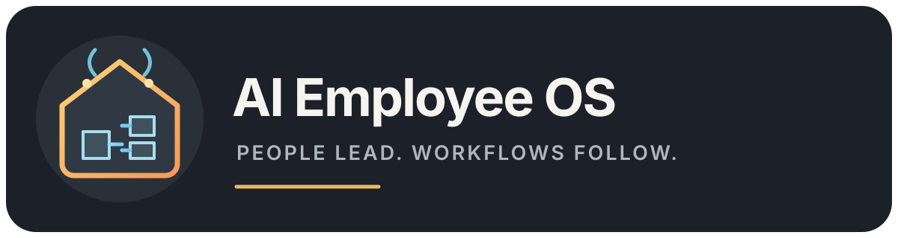

# AI Employee OS — Human-Supervised HVAC Operations

<p align="center">
  
</p>

An operations platform prototype for residential HVAC service teams. It turns inbound service requests into auditable workflows for qualification, visit scheduling, quoting, and follow-up, with people approving consequential actions.

## Project status

The repository contains an implemented local HVAC workflow slice and a replayable demo. Real phone calls and external provider actions require credentials owned by the operator. The demo uses a fixed transcript and routes email to the local Mailpit sink; it does not place a PSTN call.

## What is included

- A multi-tenant API, background worker, voice webhook, and Next.js web application.
- Organization-scoped records, PostgreSQL row-level security, and an append-only audit trail.
- A persistent lead-to-visit-to-quote workflow with retry and resume behavior.
- A Docker Compose development stack for PostgreSQL, Redis, Temporal, local object storage, Mailpit, and the application services.
- An HVAC vertical pack with fictional development data.

## Run locally

Requirements: Docker Engine with Compose, Node.js 24, and npm 11.

```sh
cp .env.example .env
npm ci
docker compose up --build
```

Open the web app at `http://localhost:13000`. The local Mailpit inbox is at `http://localhost:18025`; the API health endpoint is at `http://localhost:14000/api/health`.

Replay the sample workflow after the stack is healthy:

```sh
npm run demo
```

The demo creates fictional records in the local database. It does not send real email or call a real phone number. Keep `.env` and all provider credentials out of Git.

## Project docs

- [Architecture](docs/architecture.md)
- [Compliance and data handling](docs/compliance.md)
- [Demo walkthrough](docs/demo.md)
- [Development runbook](docs/runbook.md)
- [HVAC vertical pack](docs/vertical-pack.md)
- [Installed visual assets](docs/installed-image-assets.md)
- [Security reporting](SECURITY.md)
- [Contributing](CONTRIBUTING.md)

Useful commands include `npm run build`, `npm run typecheck`, `npm run lint`, `npm test`, and `npm run eval`.

## License

This source-available project is licensed under the [PolyForm Noncommercial License 1.0.0](LICENSE). Noncommercial use is permitted under its terms; commercial use requires separate written permission.

## Contact

Stephane Jacob <jacobstephane@outlook.com>
